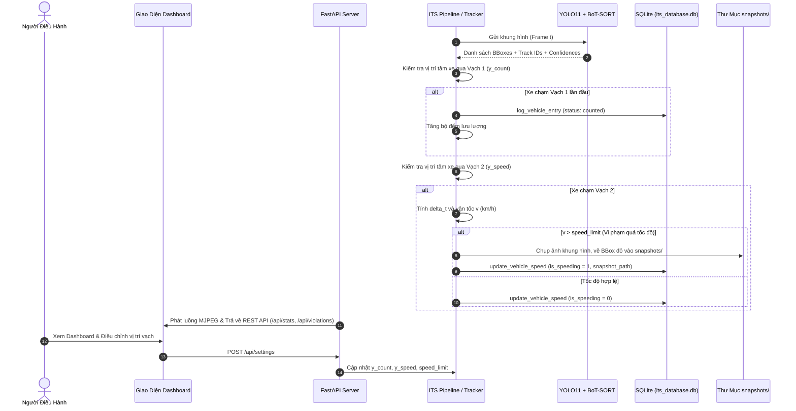

# MÔ TẢ HỆ THỐNG GIÁM SÁT GIAO THÔNG THÔNG MINH (ITS)

Tài liệu này đặc tả chi tiết toàn bộ kiến trúc kỹ thuật, các module thành phần, luồng nghiệp vụ, mô hình dữ liệu, đặc tả API và các quy tắc vận hành của Hệ thống ITS tại `D:\ITS-GiamSatXe`.

---

## 1. TỔNG QUAN VÀ ĐỐI TƯỢNG SỬ DỤNG

### 1.1. Mục tiêu hệ thống
Hệ thống được thiết kế để tự động hóa quy trình giám sát giao thông thông qua camera góc cao đặt tại các nút giao đô thị. Hệ thống thực hiện các nhiệm vụ:
- Nhận diện và theo dõi đồng thời nhiều phương tiện (Multi-Object Tracking).
- Đếm lưu lượng xe qua vạch phân chia theo loại xe (Xe máy, Ô tô, Xe tải, Xe buýt).
- Tính toán vận tốc vật lý thực tế theo mô hình Vùng đo hai vạch mốc (Speed Trap).
- Phát hiện các trường hợp chạy quá tốc độ quy định và tự động lưu trữ ảnh bằng chứng.
- Cung cấp giao diện web điều hành thời gian thực, biểu đồ thống kê và xuất báo cáo.

### 1.2. Đối tượng sử dụng
- **Cán bộ điều hành giao thông:** Theo dõi lưu lượng, quan sát camera, kiểm tra các trường hợp vi phạm và xuất dữ liệu thống kê.
- **Kỹ sư phần mềm & AI:** Quản lý mô hình, tinh chỉnh tham số tracking, hiệu chuẩn vạch đo và bảo trì cơ sở dữ liệu.

---

## 2. KIẾN TRÚC PHẦN MỀM VÀ PHÂN CHIA MODULE

Kiến trúc tổng thể của hệ thống bao gồm 7 module chính với ranh giới trách nhiệm rõ ràng:

| Module / Tệp tin | Trách nhiệm chính | Đầu vào | Đầu ra | Phụ thuộc |
| :--- | :--- | :--- | :--- | :--- |
| `its_core/config.py` | Quản lý cấu hình hệ thống, đường dẫn tệp, danh mục phương tiện và hàm xác thực tham số | Biến môi trường / Hằng số | Dict cấu hình, bool xác thực | Không |
| `its_core/homography.py` | Phép biến đổi phối cảnh 2D sang hệ tọa độ mặt đất (BEV) tính bằng mét và tính tốc độ mét | 4 điểm mốc pixel, tọa độ điểm | Ma trận H (3x3), vận tốc km/h | NumPy, OpenCV |
| `its_core/tracker.py` | Nhận diện YOLO11, theo dõi BoT-SORT, kiểm tra qua vạch, tính vận tốc và chụp ảnh vi phạm | Khung hình video (ndarray), frame_idx | Khung hình đã vẽ chú thích, dữ liệu track | Ultralytics, OpenCV, config, database |
| `its_core/pipeline.py` | Điều phối luồng đọc video, ghi video kết quả, đo FPS và báo cáo kết quả tổng hợp | Tệp tin video MP4 / Luồng RTSP | Video MP4 đầu ra, thống kê CSDL | OpenCV, tracker, database |
| `its_core/database.py` | Quản lý kết nối SQLite (WAL mode), lưu nhật ký xe, tính KPI thống kê và xuất báo cáo | Thông tin track, phiên làm việc | Bản ghi CSDL, dict KPI, list nhật ký | sqlite3 |
| `its_dashboard/server.py` | Cung cấp Web Server FastAPI, luồng MJPEG video, REST API và phục vụ ảnh tĩnh snapshots | HTTP Requests từ client | JSON responses, MJPEG stream, HTML | FastAPI, Uvicorn, core modules |
| `its_dashboard/templates/index.html` | Giao diện người dùng web, biểu đồ Chart.js, thanh điều chỉnh vạch và modal xem bằng chứng | REST API endpoints từ server | Giao diện trực quan người dùng | TailwindCSS, Font Awesome, Chart.js |

---

## 3. LUỒNG DỮ LIỆU TỔNG THỂ

---

## 4. CHI TIẾT CÁC LUỒNG NGHIỆP VỤ

### 4.1. Luồng 1: Nhận diện và Theo dõi phương tiện (Detection & Tracking)
1. **Mục đích:** Xác định vị trí tọa độ và duy trì mã định danh duy nhất (track_id) cho từng phương tiện xuyên suốt video.
2. **Thành phần:** `ITSTracker`, mô hình YOLO11, thuật toán `BoT-SORT`.
3. **Điều kiện bắt đầu:** Khung hình video hợp lệ được đọc từ `cv2.VideoCapture`.
4. **Dữ liệu đầu vào:** Khung hình `frame` (BGR, $480 \times 854$).
5. **Các bước xử lý:**
   - Đưa khung hình qua hàm `self.model.track()`.
   - Lọc các lớp đối tượng thuộc danh sách `TARGET_CLASSES` (COCO IDs: 2, 3, 5, 7).
   - Thuật toán BoT-SORT sử dụng Kalman Filter và đặc trưng ReID để ghép nối hộp bao với quỹ đạo hiện có.
   - Tránh mất dấu xe máy bằng cách sử dụng `conf=0.20` và `iou=0.50`.
6. **Điều kiện rẽ nhánh:**
   - Nếu track_id đã tồn tại trong `self.tracks`: Cập nhật tọa độ mới vào hàng đợi `history`.
   - Nếu track_id mới xuất hiện: Khởi tạo đối tượng track mới trong bộ nhớ.
7. **Dữ liệu cập nhật:** Từ điển `self.tracks[track_id]`.
8. **Kết quả đầu ra:** Danh sách hộp bao đã gán ID và nhãn phương tiện.
9. **Ngoại lệ:** Nếu không có phương tiện nào trong khung hình, bỏ qua xử lý track và chỉ vẽ vạch mốc.
10. **Liên quan:** `its_core/tracker.py` -> `process_frame()`.

### 4.2. Luồng 2: Đếm phương tiện tại Vạch 1 (Vehicle Counting)
1. **Mục đích:** Ghi nhận chính xác lưu lượng xe ngay khi tiến vào phạm vi quan sát, tránh sót xe rẽ nhánh.
2. **Thành phần:** `ITSTracker`, `ITSDatabase`.
3. **Điều kiện bắt đầu:** Phương tiện có trạng thái `counted == False`.
4. **Dữ liệu đầu vào:** Tọa độ $y$ trước đó (`prev_y`), tọa độ $y$ hiện tại (`center_y`), vị trí vạch $y_{\text{count}}$.
5. **Các bước xử lý:**
   - Kiểm tra điều kiện qua vạch theo chiều xuôi dòng: `prev_y < self.y_count and center_y >= self.y_count`.
   - Khi điều kiện thỏa mãn:
     - Gán `track["counted"] = True`.
     - Gán `track["entry_frame"] = frame_idx`.
     - Tăng bộ đếm `total_counted` và `class_counts[label_vi]`.
     - Gọi `db.log_vehicle_entry(session_id, track_id, class_name, label_vi, direction)`.
6. **Điều kiện rẽ nhánh:** Nếu `track["counted"] == True`, bỏ qua không đếm lại.
7. **Dữ liệu cập nhật:** Biến bộ đếm trong bộ nhớ và bảng `vehicle_logs` (CSDL).
8. **Kết quả đầu ra:** Bản ghi được thêm vào CSDL với `status = 'counted'`.
9. **Ngoại lệ:** Nếu xe đi ngược chiều ($y$ giảm dần), điều kiện không thỏa mãn nên không đếm.
10. **Liên quan:** `its_core/tracker.py` -> `process_frame()`, `its_core/database.py` -> `log_vehicle_entry()`.

### 4.3. Luồng 3: Đo vận tốc tại Vạch 2 (Speed Trap Measurement)
1. **Mục đích:** Tính toán vận tốc vật lý trung bình trên quãng đường $D = 8.0\text{ m}$ giữa hai vạch mốc.
2. **Thành phần:** `ITSTracker`.
3. **Điều kiện bắt đầu:** Phương tiện có `speed_locked == False` và cắt qua Vạch 2 (`prev_y < y_speed and center_y >= y_speed`).
4. **Dữ liệu đầu vào:** `entry_frame`, `frame_idx`, `fps`, `distance_meters = 8.0`.
5. **Các bước xử lý:**
   - Tính số frame di chuyển: $\Delta f = \text{frame\_idx} - \text{entry\_frame}$.
   - Tính thời gian di chuyển: $\Delta t = \Delta f / \text{fps}$ (giây).
   - Nếu $\Delta t \ge 0.15\text{s}$:
     $$v = \left(\frac{8.0}{\Delta t}\right) \times 3.6 \quad (\text{km/h})$$
     Giới hạn kết quả trong khoảng vật lý: $v = \text{clip}(v, 5.0, 90.0)$.
   - Nếu $\Delta t < 0.15\text{s}$ (xe xuất hiện đột ngột): Áp dụng giá trị ước lượng an toàn theo loại phương tiện.
   - Gán `track["speed_locked"] = True`.
6. **Điều kiện rẽ nhánh:**
   - Nếu $v > \text{speed\_limit}$: Chuyển sang luồng xử lý vi phạm.
   - Nếu $v \le \text{speed\_limit}$: Ghi nhận phương tiện di chuyển hợp lệ.
7. **Dữ liệu cập nhật:** `track["speed_kmh"]`, `track["speed_locked"] = True`.
8. **Kết quả đầu ra:** Giá trị vận tốc tính bằng km/h.
9. **Ngoại lệ:** Xe dừng lại lâu giữa hai vạch mốc khiến $\Delta t$ rất lớn sẽ cho ra vận tốc thấp (hợp lý với thực tế kẹt xe).
10. **Liên quan:** `its_core/tracker.py` -> `process_frame()`.

### 4.4. Luồng 4: Phát hiện vi phạm và Lưu ảnh bằng chứng
1. **Mục đích:** Chụp ảnh bằng chứng và đóng khung đỏ cho phương tiện chạy vượt tốc độ cho phép.
2. **Thành phần:** `ITSTracker`, thư mục `snapshots/`, `ITSDatabase`.
3. **Điều kiện bắt đầu:** Phương tiện có `speed_kmh > speed_limit` và `violation_saved == False`.
4. **Dữ liệu đầu vào:** `frame` gốc, hộp bao `box`, `track_id`, `speed_kmh`, `label_vi`.
5. **Các bước xử lý:**
   - Tạo bản sao khung hình: `snapshot_img = frame.copy()`.
   - Vẽ hộp bao màu đỏ nổi bật quanh phương tiện vi phạm.
   - Ghi dòng thông báo tiếng Việt: "VI PHẠM TỐC ĐỘ: X km/h (Giới hạn: Y km/h)".
   - Ghi thời gian vi phạm và ID phương tiện.
   - Lưu tệp ảnh vào `snapshots/violation_id{track_id}_{timestamp}_{speed}kmh.jpg`.
   - Gọi `db.update_vehicle_speed(session_id, track_id, speed_kmh, is_speeding=True, snapshot_path)`.
6. **Điều kiện rẽ nhánh:** Nếu lưu ảnh gặp lỗi I/O, hệ thống ghi nhật ký lỗi và vẫn cập nhật CSDL với `snapshot_path = None`.
7. **Dữ liệu cập nhật:** Tệp ảnh trong `snapshots/`, cột `is_speeding = 1` trong bảng `vehicle_logs`.
8. **Kết quả đầu ra:** Tệp ảnh JPG bằng chứng và đường dẫn tham chiếu.
9. **Ngoại lệ:** Cùng một phương tiện chỉ chụp duy nhất 1 lần nhờ biến cờ `violation_saved`.
10. **Liên quan:** `its_core/tracker.py` -> `_save_violation_snapshot()`.

### 4.5. Luồng 5: Đồng bộ dữ liệu lên Web Dashboard
1. **Mục đích:** Hiển thị thời gian thực các chỉ số KPI, biểu đồ phân bổ và hình ảnh bằng chứng.
2. **Thành phần:** `its_dashboard/server.py`, `index.html`, Chart.js.
3. **Điều kiện bắt đầu:** Trình duyệt gửi request định kỳ (polling mỗi 1.5 giây).
4. **Dữ liệu đầu vào:** `GET /api/stats`, `GET /api/violations`, `GET /api/history`.
5. **Các bước xử lý:**
   - Server truy vấn SQLite lấy `get_summary_stats()`, `get_recent_violations()`, `get_all_records()`.
   - Trả về JSON cho frontend.
   - Frontend cập nhật DOM: số lượng xe, biểu đồ tròn Chart.js, danh sách thẻ vi phạm.
6. **Điều kiện rẽ nhánh:** Nếu không có vi phạm, hiển thị thông báo "Chưa ghi nhận trường hợp vi phạm tốc độ nào".
7. **Dữ liệu cập nhật:** DOM HTML trên trình duyệt.
8. **Kết quả đầu ra:** Giao diện trực quan cập nhật liên tục.
9. **Ngoại lệ:** Nếu mất kết nối mạng, frontend hiển thị thông báo lỗi trên console và tự động thử lại sau 1.5 giây.
10. **Liên quan:** `its_dashboard/server.py`, `its_dashboard/templates/index.html`.

---

## 5. MÔ HÌNH DỮ LIỆU (DATABASE SCHEMA)

Cơ sở dữ liệu SQLite `its_database.db` sử dụng 2 bảng chính:

### 5.1. Bảng `vehicle_logs`
Lưu trữ thông tin chi tiết về từng phương tiện đi qua trạm quan sát:

| Tên trường | Kiểu dữ liệu | Ràng buộc | Ý nghĩa |
| :--- | :--- | :--- | :--- |
| `id` | INTEGER | PRIMARY KEY AUTOINCREMENT | Khóa chính tự tăng |
| `session_id` | TEXT | NOT NULL DEFAULT 'default_session' | Mã phiên giám sát |
| `track_id` | INTEGER | NOT NULL | Mã ID do BoT-SORT cấp |
| `class_name` | TEXT | NOT NULL | Tên lớp tiếng Anh (car, motorcycle, bus, truck) |
| `label_vi` | TEXT | NOT NULL | Nhãn tiếng Việt (Ô tô, Xe máy, Xe buýt, Xe tải) |
| `entry_time` | DATETIME | DEFAULT CURRENT_TIMESTAMP | Thời điểm chạm Vạch 1 |
| `exit_time` | DATETIME | NULL | Thời điểm chạm Vạch 2 (chốt tốc độ) |
| `speed_kmh` | REAL | NULL | Vận tốc chốt được (km/h) |
| `is_speeding` | INTEGER | DEFAULT 0 | Cờ đánh dấu vi phạm (1: Có, 0: Không) |
| `direction` | TEXT | DEFAULT 'Xuôi dòng' | Hướng di chuyển |
| `status` | TEXT | DEFAULT 'counted' | Trạng thái ('counted' hoặc 'speed_locked') |
| `crossed_line` | INTEGER | DEFAULT 1 | Cờ xác nhận đã qua vạch |
| `timestamp` | DATETIME | DEFAULT CURRENT_TIMESTAMP | Thời điểm cập nhật bản ghi |
| `snapshot_path` | TEXT | NULL | Đường dẫn tệp ảnh bằng chứng vi phạm |

**Chỉ mục & Ràng buộc:**
- `CREATE UNIQUE INDEX uq_idx_session_track ON vehicle_logs(session_id, track_id);`
- `CREATE INDEX idx_logs_is_speeding ON vehicle_logs(is_speeding);`
- `CREATE INDEX idx_logs_timestamp ON vehicle_logs(timestamp);`
- `CREATE INDEX idx_logs_crossed ON vehicle_logs(crossed_line);`

### 5.2. Bảng `traffic_stats`
Lưu trữ dữ liệu chuỗi thời gian (time-series) tổng hợp lưu lượng định kỳ:

| Tên trường | Kiểu dữ liệu | Ràng buộc | Ý nghĩa |
| :--- | :--- | :--- | :--- |
| `id` | INTEGER | PRIMARY KEY AUTOINCREMENT | Khóa chính |
| `session_id` | TEXT | NOT NULL | Mã phiên |
| `timestamp` | DATETIME | DEFAULT CURRENT_TIMESTAMP | Thời điểm lấy mẫu |
| `total_count` | INTEGER | DEFAULT 0 | Tổng số xe tại thời điểm đó |
| `motorcycles` | INTEGER | DEFAULT 0 | Số lượng xe máy |
| `cars` | INTEGER | DEFAULT 0 | Số lượng ô tô |
| `buses` | INTEGER | DEFAULT 0 | Số lượng xe buýt |
| `trucks` | INTEGER | DEFAULT 0 | Số lượng xe tải |
| `avg_speed` | REAL | DEFAULT 0.0 | Vận tốc trung bình |
| `violations` | INTEGER | DEFAULT 0 | Số vụ vi phạm |

---

## 6. DANH SÁCH REST API ENDPOINTS

| Endpoint | Phương thức | Mô tả | Dữ liệu gửi lên (Payload) | Dữ liệu trả về (Response) |
| :--- | :--- | :--- | :--- | :--- |
| `/` | `GET` | Cung cấp giao diện Web Dashboard | Không | Trang HTML đầy đủ |
| `/video_feed` | `GET` | Luồng phát video trực tiếp MJPEG | Không | Multipart stream image/jpeg |
| `/api/stats` | `GET` | Lấy số liệu KPI thống kê và trạng thái | Không | JSON tổng hợp KPI, FPS, tham số |
| `/api/violations` | `GET` | Lấy 12 trường hợp vi phạm mới nhất | Không | JSON danh sách vi phạm kèm URL ảnh |
| `/api/history` | `GET` | Lấy 50 phương tiện qua trạm gần nhất | Không | JSON danh sách nhật ký xe |
| `/api/settings` | `POST` | Cập nhật vị trí 2 vạch và ngưỡng tốc độ | JSON: `{speed_limit, y_count_ratio, y_speed_ratio}` | JSON xác nhận trạng thái |
| `/api/reset` | `POST` | Đặt lại số liệu phiên giám sát | Không | JSON: `{"status": "success", "session_id": "..."}` |
| `/api/export` | `GET` | Xuất toàn bộ nhật ký xe ra tệp CSV | Không | File CSV UTF-8 kèm BOM |
| `/snapshots/{file}` | `GET` | Phục vụ xem ảnh tĩnh bằng chứng | Không | Dữ liệu ảnh JPEG |

---

## 7. QUY TẮC NGHIỆP VỤ VÀ CÁC TRƯỜNG HỢP NGOẠI LỆ

1. **Quy tắc xác định điểm đại diện của phương tiện:**
   - Sử dụng tọa độ tâm hộp bao $(cx, cy) = \left(\frac{x_1 + x_2}{2}, \frac{y_1 + y_2}{2}\right)$.
   - Lý do: Đối với camera đặt góc cao chéo, tâm hộp bao thể hiện trọng tâm hình học ổn định nhất, ít chịu ảnh hưởng bởi biến dạng bóng đổ trên mặt đường hơn là điểm tiếp giáp đáy hộp bao.

2. **Quy tắc tính vận tốc vật lý:**
   - Chỉ chốt vận tốc khi $\Delta t \ge 0.15\text{ giây}$. Nếu $\Delta t < 0.15\text{ giây}$, sử dụng ước lượng an toàn theo loại xe để tránh gây biến động tốc độ bất thường.
   - Kết quả được cắt gọn (clamp) trong đoạn vật lý $[5.0\text{ km/h}, 90.0\text{ km/h}]$.

3. **Quy tắc xác định vi phạm quá tốc độ:**
   - Phương tiện bị coi là vi phạm khi và chỉ khi: $v_{\text{chốt}} > \text{speed\_limit}$.
   - Trường hợp $v_{\text{chốt}} = \text{speed\_limit}$ được xem là hợp lệ.

4. **Quy tắc phòng chống duyệt thư mục trái phép (Path Traversal Prevention):**
   - Mọi thao tác xử lý đường dẫn ảnh bằng chứng tại endpoint `/api/violations` phải qua hàm `os.path.basename()` để triệt tiêu các ký tự độc hại như `../` hoặc đường dẫn tuyệt đối.

---

## 8. GIỚI HẠN VÀ HƯỚNG PHÁT TRIỂN

### 8.1. Giới hạn hệ thống
- Khoảng cách 8.0 mét hiện tại được hiệu chuẩn cố định dựa trên kích thước vật thể thực tế tại nút giao Ngã Tư Ga. Khi triển khai tại camera khác, cần đo đạc khoảng cách thực tế trên hiện trường và cập nhật tham số `real_distance_meters`.
- Chức năng nhận diện biển số xe (ALPR) chưa được tích hợp trong bản nâng cấp này do độ phân giải video gốc $480 \times 854$ không đủ rõ để đọc ký tự biển số.

### 8.2. Hướng phát triển tiếp theo
- Tích hợp thêm module ALPR với mô hình nhận diện ký tự (OCR) khi sử dụng camera độ phân giải cao (FullHD / 4K).
- Hỗ trợ lưu trữ phân tán sang PostgreSQL / MySQL cho hệ thống giao thông quy mô toàn thành phố.
- Phát triển module cảnh báo tự động qua Webhook / Telegram khi phát hiện phương tiện chạy quá tốc độ nghiêm trọng (> 80 km/h).
