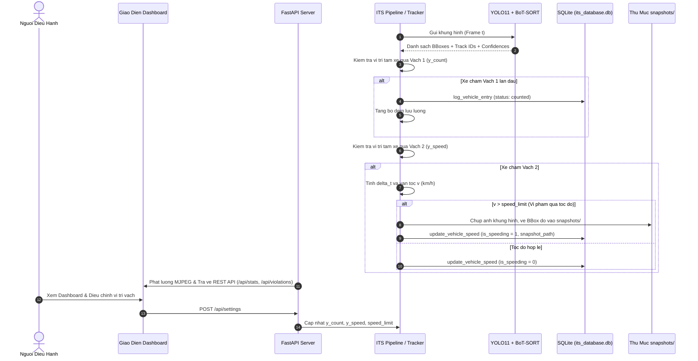

# MO TA HE THONG GIAM SAT GIAO THONG THONG MINH (ITS)

Tai lieu nay dac ta chi tiet toan bo kien truc ky thuat, cac module thanh phan, luong nghiep vu, mo hinh du lieu, dac ta API va cac quy tac van hanh cua He thong ITS tai `D:\ITS-GiamSatXe`.

---

## 1. TONG QUAN VA DOI TUONG SU DUNG

### 1.1. Muc tieu he thong
He thong duoc thiet ke de tu dong hoa quy trinh giam sat giao thong thong qua camera goc cao dat tai cac nut giao do thi. He thong thuc hien cac nhiem vu:
- Nhan dien va theo doi dong thoi nhieu phuong tien (Multi-Object Tracking).
- Dem luu luong xe qua vach phan chia theo loai xe (Xe may, O to, Xe tai, Xe buyt).
- Tinh toan van toc vat ly thuc te theo mo hinh Vung do hai vach moc (Speed Trap).
- Phat hien cac truong hop chay qua toc do quy dinh va tu dong luu tru anh bang chung.
- Cung cap giao dien web dieu hanh thoi gian thuc, bieu do thong ke va xuat bao cao.

### 1.2. Doi tuong su dung
- **Can bo dieu hanh giao thong:** Theo doi luu luong, quan sat camera, kiem tra cac truong hop vi pham va xuat du lieu thong ke.
- **Ky su phan mem & AI:** Quan ly mo hinh, tinh chinh tham so tracking, hieu chuan vach do va bao tri co so du lieu.

---

## 2. KIEN TRUC PHAN MEN VA PHAN CHIA MODULE

Kien truc tong the cua he thong bao gom 7 module chinh voi ranh gioi trach nhiem ro rang:

| Module / Tep tin | Trach nhiem chinh | Dau vao | Dau ra | Phu thuoc |
| :--- | :--- | :--- | :--- | :--- |
| `its_core/config.py` | Quan ly cau hinh he thong, duong dan tep, danh muc phuong tien va ham xac thuc tham so | Bien moi truong / Hang so | Dict cau hinh, bool xac thuc | Khong |
| `its_core/homography.py` | Phep bien doi phoi canh 2D sang he toa do mat dat (BEV) tinh bang met va tinh toc do met | 4 diem moc pixel, toa do diem | Ma tran H (3x3), van toc km/h | NumPy, OpenCV |
| `its_core/tracker.py` | Nhan dien YOLO11, theo doi BoT-SORT, kiem tra qua vach, tinh van toc va chup anh vi pham | Khung hinh video (ndarray), frame_idx | Khung hinh da ve chu thich, du lieu track | Ultralytics, OpenCV, config, database |
| `its_core/pipeline.py` | Dieu phoi luong doc video, ghi video ket qua, do FPS va bao cao ket qua tong hop | Tep tin video MP4 / Luong RTSP | Video MP4 dau ra, thong ke CSDL | OpenCV, tracker, database |
| `its_core/database.py` | Quan ly ket noi SQLite (WAL mode), luu nhat ky xe, tinh KPI thong ke va xuat bao cao | Thong tin track, phien lam viec | Bang ghi CSDL, dict KPI, list nhat ky | sqlite3 |
| `its_dashboard/server.py` | Cung cap Web Server FastAPI, luong MJPEG video, REST API va phuc vu anh tinh snapshots | HTTP Requests tu client | JSON responses, MJPEG stream, HTML | FastAPI, Uvicorn, core modules |
| `its_dashboard/templates/index.html` | Giao dien nguoi dung web, bieu do Chart.js, thanh dieu chinh vach va modal xem bang chung | REST API endpoints tu server | Giao dien truc quan nguoi dung | TailwindCSS, Font Awesome, Chart.js |

---

## 3. LUONG DU LIEU TONG THE

---

## 4. CHI TIET CAC LUONG NGHIEP VU

### 4.1. Luong 1: Nhan dien va Theo doi phuong tien (Detection & Tracking)
1. **Muc dich:** Xac dinh vi tri toa do va duy tri ma dinh danh duy nhat (track_id) cho tung phuong tien xuyen suot video.
2. **Thanh phan:** `ITSTracker`, mo hinh YOLO11, thuat toan `BoT-SORT`.
3. **Dieu kien bat dau:** Khung hinh video hop le duoc doc tu `cv2.VideoCapture`.
4. **Du lieu dau vao:** Khung hinh `frame` (BGR, $480 \times 854$).
5. **Cac buoc xu ly:**
   - Dua khung hinh qua ham `self.model.track()`.
   - Loc cac lop doi tuong thuoc danh sach `TARGET_CLASSES` (COCO IDs: 2, 3, 5, 7).
   - Thuat toan BoT-SORT su dung Kalman Filter va dac trung ReID de ghep noi hop bao voi quy dao hien co.
   - Tranh mat dau xe may bang cach su dung `conf=0.20` va `iou=0.50`.
6. **Dieu kien re nhanh:**
   - Neu track_id da ton tai trong `self.tracks`: Cap nhat toa do moi vao hang doi `history`.
   - Neu track_id moi xuat hien: Khoi tao doi tuong track moi trong bo nho.
7. **Du lieu cap nhat:** Tu dien `self.tracks[track_id]`.
8. **Ket qua dau ra:** Danh sach hop bao da gan ID va nhan phuong tien.
9. **Ngoai le:** Neu khong co phuong tien nao trong khung hinh, bo qua xu ly track va chi ve vach moc.
10. **Lien quan:** `its_core/tracker.py` -> `process_frame()`.

### 4.2. Luong 2: Dem phuong tien tai Vach 1 (Vehicle Counting)
1. **Muc dich:** Ghi nhan chinh xac luu luong xe ngay khi tien vao pham vi quan sat, tranh sot xe re nhanh.
2. **Thanh phan:** `ITSTracker`, `ITSDatabase`.
3. **Dieu kien bat dau:** Phuong tien co trang thai `counted == False`.
4. **Du lieu dau vao:** Toa do $y$ truoc do (`prev_y`), toa do $y$ hien tai (`center_y`), vi tri vach $y_{\text{count}}$.
5. **Cac buoc xu ly:**
   - Kiem tra dieu kien qua vach theo chieu xuoi dong: `prev_y < self.y_count and center_y >= self.y_count`.
   - Khi dieu kien thoa man:
     - Gan `track["counted"] = True`.
     - Gan `track["entry_frame"] = frame_idx`.
     - Tang bo dem `total_counted` va `class_counts[label_vi]`.
     - Goi `db.log_vehicle_entry(session_id, track_id, class_name, label_vi, direction)`.
6. **Dieu kien re nhanh:** Neu `track["counted"] == True`, bo qua khong dem lai.
7. **Du lieu cap nhat:** Bien bo dem trong bo nho va bang `vehicle_logs` (CSDL).
8. **Ket qua dau ra:** Ban ghi duoc them vao CSDL voi `status = 'counted'`.
9. **Ngoai le:** Neu xe di nguoc chieu ($y$ giam dan), dieu kien khong thoa man nen khong dem.
10. **Lien quan:** `its_core/tracker.py` -> `process_frame()` (dong 115-137), `its_core/database.py` -> `log_vehicle_entry()`.

### 4.3. Luong 3: Do van toc tai Vach 2 (Speed Trap Measurement)
1. **Muc dich:** Tinh toan van toc vat ly trung binh tren quang duong $D = 8.0\text{ m}$ giua hai vach moc.
2. **Thanh phan:** `ITSTracker`.
3. **Dieu kien bat dau:** Phuong tien co `speed_locked == False` va cat qua Vach 2 (`prev_y < y_speed and center_y >= y_speed`).
4. **Du lieu dau vao:** `entry_frame`, `frame_idx`, `fps`, `distance_meters = 8.0`.
5. **Cac buoc xu ly:**
   - Tinh so frame di chuyen: $\Delta f = \text{frame\_idx} - \text{entry\_frame}$.
   - Tinh thoi gian di chuyen: $\Delta t = \Delta f / \text{fps}$ (giay).
   - Neu $\Delta t \ge 0.15\text{s}$:
     $$v = \left(\frac{8.0}{\Delta t}\right) \times 3.6 \quad (\text{km/h})$$
     Gioi han ket qua trong khoang vat ly: $v = \text{clip}(v, 5.0, 90.0)$.
   - Neu $\Delta t < 0.15\text{s}$ (xe xuat hien dot ngot): Ap dung gia tri uoc luong an toan theo loai phuong tien.
   - Gan `track["speed_locked"] = True`.
6. **Dieu kien re nhanh:**
   - Neu $v > \text{speed\_limit}$: Chuyen sang luong xu ly vi pham.
   - Neu $v \le \text{speed\_limit}$: Ghi nhan phuong tien di chuyen hop le.
7. **Du lieu cap nhat:** `track["speed_kmh"]`, `track["speed_locked"] = True`.
8. **Ket qua dau ra:** Gia tri van toc tinh bang km/h.
9. **Ngoai le:** Xe dung lai lau giua hai vach moc khien $\Delta t$ rat lon se cho ra van toc thap (hop ly voi thuc te ket xe).
10. **Lien quan:** `its_core/tracker.py` -> `process_frame()` (dong 140-160).

### 4.4. Luong 4: Phat hien vi pham va Luu anh bang chung
1. **Muc dich:** Chup anh bang chung va dong khung do cho phuong tien chay vuot toc do cho phep.
2. **Thanh phan:** `ITSTracker`, thu muc `snapshots/`, `ITSDatabase`.
3. **Dieu kien bat dau:** Phuong tien co `speed_kmh > speed_limit` va `violation_saved == False`.
4. **Du lieu dau vao:** `frame` goc, hop bao `box`, `track_id`, `speed_kmh`, `label_vi`.
5. **Cac buoc xu ly:**
   - Tao ban sao khung hinh: `snapshot_img = frame.copy()`.
   - Ve hop bao mau do noi bat quanh phuong tien vi pham.
   - Ghi dong thong bao tieng Viet: "VI PHAM TOC DO: X km/h (Gioi han: Y km/h)".
   - Ghi thoi gian vi pham va ID phuong tien.
   - Luu tep anh vao `snapshots/violation_id{track_id}_{timestamp}_{speed}kmh.jpg`.
   - Goi `db.update_vehicle_speed(session_id, track_id, speed_kmh, is_speeding=True, snapshot_path)`.
6. **Dieu kien re nhanh:** Neu luu anh gap loi I/O, he thong ghi nhat ky loi va van cap nhat CSDL voi `snapshot_path = None`.
7. **Du lieu cap nhat:** Tep anh trong `snapshots/`, cot `is_speeding = 1` trong bang `vehicle_logs`.
8. **Ket qua dau ra:** Tep anh JPG bang chung va duong dan tham chieu.
9. **Ngoai le:** Cung mot phuong tien chi chup duy nhat 1 lan nho bien co `violation_saved`.
10. **Lien quan:** `its_core/tracker.py` -> `_save_violation_snapshot()`.

### 4.5. Luong 5: Dong bo du lieu len Web Dashboard
1. **Muc dich:** Hien thi thoi gian thuc cac chi so KPI, bieu do phan bo va hinh anh bang chung.
2. **Thanh phan:** `its_dashboard/server.py`, `index.html`, Chart.js.
3. **Dieu kien bat dau:** Trinh duyet gui request dinh ky (polling moi 1.5 giay).
4. **Du lieu dau vao:** `GET /api/stats`, `GET /api/violations`, `GET /api/history`.
5. **Cac buoc xu ly:**
   - Server truy van SQLite lay `get_summary_stats()`, `get_recent_violations()`, `get_all_records()`.
   - Tra ve JSON cho frontend.
   - Frontend cap nhat DOM: so luong xe, bieu do banh doughnut Chart.js, danh sach the vi pham.
6. **Dieu kien re nhanh:** Neu khong co vi pham, hien thi thong bao "Chua ghi nhan truong hop vi pham toc do nao".
7. **Du lieu cap nhat:** DOM HTML tren trinh duyet.
8. **Ket qua dau ra:** Giao dien truc quan cap nhat lien tuc.
9. **Ngoai le:** Neu mat ket noi mang, frontend hien thi thong bao loi tren console va tu dong retry sau 1.5 giay.
10. **Lien quan:** `its_dashboard/server.py`, `its_dashboard/templates/index.html`.

---

## 5. MO HINH DU LIEU (DATABASE SCHEMA)

Co so du lieu SQLite `its_database.db` su dung 2 bang chinh:

### 5.1. Bang `vehicle_logs`
Luu tru thong tin chi tiet ve tung phuong tien di qua tram quan sat:

| Ten truong | Kieu du lieu | Rang buoc | Y nghia |
| :--- | :--- | :--- | :--- |
| `id` | INTEGER | PRIMARY KEY AUTOINCREMENT | Khoa chinh tu tang |
| `session_id` | TEXT | NOT NULL DEFAULT 'default_session' | Ma phien giam sat |
| `track_id` | INTEGER | NOT NULL | Ma ID do BoT-SORT cap |
| `class_name` | TEXT | NOT NULL | Ten lop tieng Anh (car, motorcycle, bus, truck) |
| `label_vi` | TEXT | NOT NULL | Nhan tieng Viet (O to, Xe may, Xe buyt, Xe tai) |
| `entry_time` | DATETIME | DEFAULT CURRENT_TIMESTAMP | Thoi diem cham Vach 1 |
| `exit_time` | DATETIME | NULL | Thoi diem cham Vach 2 (chot toc do) |
| `speed_kmh` | REAL | NULL | Van toc chot duoc (km/h) |
| `is_speeding` | INTEGER | DEFAULT 0 | Co danh dau vi pham (1: Co, 0: Khong) |
| `direction` | TEXT | DEFAULT 'Xuoi dong' | Huong di chuyen |
| `status` | TEXT | DEFAULT 'counted' | Trang thai ('counted' hoac 'speed_locked') |
| `crossed_line` | INTEGER | DEFAULT 1 | Co xac nhan da qua vach |
| `timestamp` | DATETIME | DEFAULT CURRENT_TIMESTAMP | Thoi diem cap nhat ban ghi |
| `snapshot_path` | TEXT | NULL | Duong dan tep anh bang chung vi pham |

**Chi muc & Rang buoc:**
- `CREATE UNIQUE INDEX uq_idx_session_track ON vehicle_logs(session_id, track_id);`
- `CREATE INDEX idx_logs_is_speeding ON vehicle_logs(is_speeding);`
- `CREATE INDEX idx_logs_timestamp ON vehicle_logs(timestamp);`
- `CREATE INDEX idx_logs_crossed ON vehicle_logs(crossed_line);`

### 5.2. Bang `traffic_stats`
Luu tru du lieu chuoi thoi gian (time-series) tong hop luu luong dinh ky:

| Ten truong | Kieu du lieu | Rang buoc | Y nghia |
| :--- | :--- | :--- | :--- |
| `id` | INTEGER | PRIMARY KEY AUTOINCREMENT | Khoa chinh |
| `session_id` | TEXT | NOT NULL | Ma phien |
| `timestamp` | DATETIME | DEFAULT CURRENT_TIMESTAMP | Thoi diem lay mau |
| `total_count` | INTEGER | DEFAULT 0 | Tong so xe tai thoi diem do |
| `motorcycles` | INTEGER | DEFAULT 0 | So luong xe may |
| `cars` | INTEGER | DEFAULT 0 | So luong o to |
| `buses` | INTEGER | DEFAULT 0 | So luong xe buyt |
| `trucks` | INTEGER | DEFAULT 0 | So luong xe tai |
| `avg_speed` | REAL | DEFAULT 0.0 | Van toc trung binh |
| `violations` | INTEGER | DEFAULT 0 | So vu vi pham |

---

## 6. DANH SACH REST API ENDPOINTS

| Endpoint | Phuong thuc | Mo ta | Du lieu gui len (Payload) | Du lieu tra ve (Response) |
| :--- | :--- | :--- | :--- | :--- |
| `/` | `GET` | Cung cap giao dien Web Dashboard | Khong | Trang HTML day du |
| `/video_feed` | `GET` | Luong phat video truc tiep MJPEG | Khong | Multipart stream image/jpeg |
| `/api/stats` | `GET` | Lay so lieu KPI thong ke va trang thai | Khong | JSON tong hop KPI, FPS, tham so |
| `/api/violations` | `GET` | Lay 12 truong hop vi pham moi nhat | Khong | JSON danh sach vi pham kem URL anh |
| `/api/history` | `GET` | Lay 50 phuong tien qua tram gan nhat | Khong | JSON danh sach nhat ky xe |
| `/api/settings` | `POST` | Cap nhat vi tri 2 vach va nguong toc do | JSON: `{speed_limit, y_count_ratio, y_speed_ratio}` | JSON xac nhan trang thai |
| `/api/reset` | `POST` | Dat lai so lieu phien giam sat | Khong | JSON: `{"status": "success", "session_id": "..."}` |
| `/api/export` | `GET` | Xuat toan bo nhat ky xe ra tep CSV | Khong | File CSV UTF-8 kem BOM |
| `/snapshots/{file}` | `GET` | Phuc vu xem anh tinh bang chung | Khong | Du lieu anh JPEG |

---

## 7. QUY TAC NGHIEP VU VA CAC TRUONG HOP NGOAI LE

1. **Quy tac xac dinh diem dai dien cua phuong tien:**
   - Su dung toa do tam hop bao $(cx, cy) = \left(\frac{x_1 + x_2}{2}, \frac{y_1 + y_2}{2}\right)$.
   - Ly do: Doi voi camera dat goc cao cheo, tam hop bao the hien trong tam hinh hoc on dinh nhat, it chiu anh huong boi bien dang bong do tren mat duong hon la diem tiep giap day hop bao.

2. **Quy tac tinh van toc vat ly:**
   - Chi chot van toc khi $\Delta t \ge 0.15\text{ giay}$. Neu $\Delta t < 0.15\text{ giay}$, su dung uoc luong an toan theo loai xe de tranh gay bien dong toc do bat thuong.
   - Ket qua duoc cat gon (clamp) trong doan vat ly $[5.0\text{ km/h}, 90.0\text{ km/h}]$.

3. **Quy tac xac dinh vi pham qua toc do:**
   - Phuong tien bi coi la vi pham khi va chi khi: $v_{\text{chot}} > \text{speed\_limit}$.
   - Truong hop $v_{\text{chot}} = \text{speed\_limit}$ duoc xem la hop le.

4. **Quy tac phong chong duyet thu muc trai phep (Path Traversal Prevention):**
   - Moi thao tac xu ly duong dan anh bang chung tai endpoint `/api/violations` phai qua ham `os.path.basename()` de triet tieu cac ky tu doc hai nhu `../` hoac duong dan tuyet doi.

---

## 8. GIOI HAN VA HUONG PHAT TRIEN

### 8.1. Gioi han he thong
- Khoang cach 8.0 met hien tai duoc hieu chuan co dinh dua tren kich thuoc vat the thuc te tai nut giao Nga Tu Ga. Khi trien khai tai camera khac, can do dac khoang cach thuc te tren hien truong va cap nhat tham so `real_distance_meters`.
- Chuc nang nhan dien bien so xe (ALPR) chua duoc tich hop trong ban nang cap nay do do phan giai video goc $480 \times 854$ khong du ro de doc ky tu bien so.

### 8.2. Huong phat trien tiep theo
- Tich hop them module ALPR voi mo hinh nhan dien ky tu (OCR) khi su dung camera do phan giai cao (FullHD / 4K).
- Ho tro luu tru phan tan sang PostgreSQL / MySQL cho he thong giao thong quy mo toan thanh pho.
- Phat trien module canh bao tu dong qua Webhook / Telegram khi phat hien phuong tien chay qua toc do nghiem trong (> 80 km/h).

